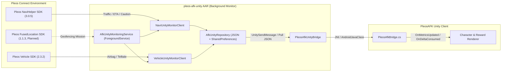

# Pleos AFK — 사회 초년 여성운전자를 위한 감성 방치형 인포테인먼트 시스템

> **현대자동차그룹 차량용 앱 개발 공모전 출품작 참고용 저장소**
>
> 감성 캐릭터 파트너가 실시간 주행 이벤트를 수집해 초보 운전자를 응원하고, 매일의 안전 주행이 쌓여 함께 성장해 나가는 Pleos Connect 기반 맞춤형 드라이빙 동반자 프로젝트입니다.

---

## 1. 저장소 구성 (Repository Structure)

본 저장소는 백그라운드에서 주행·차량 데이터를 상시 수집하는 **Android 네이티브 서비스/라이브러리 프로젝트(`pleos-afk`)**와 이를 수신해 캐릭터 인터랙션 및 보상을 렌더링하는 **Unity 클라이언트 프로젝트(`PleosAFK`)**로 구성됩니다.

```text
.
├── pleos-afk/                              # Android 네이티브 상시 수집 모듈 & 검증용 대시보드 앱
│   ├── pleos-afk-unity/                    # Unity 연동용 Android Library (.aar) 모듈
│   │   └── src/main/java/ai/pleos/playground/afk/unity/
│   │       ├── PleosAfkUnityBridge.kt      # Unity C# (AndroidJavaClass) 호출 진입점
│   │       ├── service/AfkUnityMonitoringService.kt   # dataSync ForegroundService
│   │       ├── sdk/NaviUnityMonitorClient.kt          # Pleos NaviHelper SDK 리스너
│   │       ├── sdk/VehicleUnityMonitorClient.kt       # Pleos Vehicle SDK (Safety) 리스너
│   │       ├── data/AfkUnityRepository.kt             # 메트릭/델타 정산 및 JSON 직렬화·저장
│   │       └── model/AfkUnityMetrics.kt               # AfkUnityMetrics / AfkPendingDelta
│   ├── app/                                # 단독 테스트 및 로컬 시뮬레이션용 Jetpack Compose 앱
│   │   └── src/main/java/ai/pleos/playground/afk/
│   │       ├── MainActivity.kt
│   │       ├── ui/AfkDashboardScreen.kt    # 수집 메트릭 실시간 모니터링 및 시뮬레이션 UI
│   │       ├── service/AfkMonitoringService.kt
│   │       ├── sdk/NaviMonitorClient.kt
│   │       ├── sdk/VehicleMonitorClient.kt
│   │       ├── data/AfkMetricsRepository.kt
│   │       └── model/AfkMetricsState.kt
│   └── unity-sample/                       # Unity 브릿지 연동 가이드 및 원본 C# 스크립트
│       ├── PleosAfkBridge.cs
│       └── README.md
│
└── PleosAFK/                               # Unity (6000.3.28f1) 인포테인먼트 클라이언트
    ├── Assets/
    │   ├── Plugins/Android/
    │   │   ├── pleos-afk-unity-release.aar # :pleos-afk-unity 빌드 산출물
    │   │   ├── mainTemplate.gradle         # Pleos NaviHelper / Vehicle SDK 의존성 선언
    │   │   └── settingsTemplate.gradle     # Pleos Playground Maven 저장소 설정
    │   ├── Scripts/PleosAfkBridge.cs       # Android 브릿지 연동 및 C# 이벤트 발행
    │   └── Scenes/SampleScene.unity
    ├── Packages/
    └── ProjectSettings/
```

---

## 2. 시스템 아키텍처 (System Architecture)

주행 중에는 내비게이션 앱이 화면(포그라운드)을 점유하고 차량 인포테인먼트 앱이 뒤로 물러나는 환경에서도 주행 이벤트가 유실되지 않도록 **Android `ForegroundService` (`dataSync`) 기반 상시 수집 + Unity 3D 하이브리드 브릿지** 구조로 설계했습니다.



1. **네이티브 상시 수집**: Unity 앱이 `PleosAfkBridge.StartMonitoring()`을 호출하면 `AfkUnityMonitoringService`가 실행되어 내비게이션 사용 중에도 `NaviHelper` 및 `Vehicle` 리스너 연결을 유지합니다.
2. **상태 영속화 및 변화량(Delta) 누적**: `AfkUnityRepository`는 수집된 지표를 JSON 문자열로 직렬화하여 `SharedPreferences`(`pleos_afk_unity_prefs`)에 스냅샷(`latest_metrics_json`)과 미정산 누적 변화량(`pending_delta_json`)을 실시간 저장합니다.
3. **복귀 시 일괄 정산**: 주행 종료 후 운전자가 Unity 앱 화면으로 복귀(`OnApplicationPause(false)`)하면 `PleosAfkBridge`가 `RefreshMetrics()`와 `ConsumePendingDelta()`를 호출해 주행 중 누적된 델타를 일괄 소비하고 캐릭터 보상 및 성장 연출을 트리거합니다. 포그라운드 상태에서는 `UnityPlayer.UnitySendMessage`를 통해 실시간 갱신도 지원합니다.

---

## 3. Pleos Connect SDK 활용 내역

### 현재 프로토타입 구현 범위

| SDK / API | 버전 | 연동 클래스 | 구현 기능 |
| :--- | :--- | :--- | :--- |
| **Pleos `NaviHelper` SDK** | `3.0.5` | `NaviUnityMonitorClient`<br>`NaviMonitorClient` | `NaviHelperEventListener` 콜백(`onRouteStarted`, `onRouteCancelled`, `onRouteStateInfo`, `onDrivingInfo`, `onTripInfo`, `onCautionPointInfo`)을 통해 정체 구간 거리·시간·평균 속도, `SLOW`/`HEAVY` 구간 수, `ACCIDENT`/`REPAIRING`/`ROAD_DAMAGE` 교통 이벤트, ETA 지연 시간, 전방 주의구간 수 수집 |
| **Pleos `Vehicle` SDK** | `2.3.2` | `VehicleUnityMonitorClient`<br>`VehicleMonitorClient` | `Vehicle.getSafety()` 기반 좌석별 에어백 전개 감지(`checkAirbagDeployedCapabilities`, `registerSeatAirbagDeployed`) 및 차량 경고등(`registerTelltales`) 수집 |
| **로컬 검증 시뮬레이터** | - | `AfkDashboardScreen`<br>`PleosAfkUnityBridge` | 실차/에뮬레이터 서비스 미연결 환경에서도 정체(`+5m Congestion`), 사고(`+1 Road Accident`), 에어백 전개(`Airbag Deployed`) 이벤트를 주입해 점수 및 델타 정산 검증 가능 |

### 공모전 기획 확장 로드맵 (Pleos Connect API 연동 설계)

- **Pleos `NaviHelper` SDK**: `onTBTInfo`(`TurnType.TURN_ENTER_IC_*`, `TURN_TOLL`, `TURN_ENTER_SERVICEAREA`), `onCameraAlert`, `onCurrentRoadSpeedLimit`, `onDestinationArrived` 연동을 통한 주의구간 음성 응원 및 고속도로·초행길 완주 업적 판별
- **Pleos `Vehicle` SDK & Android Automotive OS**: `CarPropertyManager`(`GEAR_SELECTION`) 기반 주행(D단) 터치 잠금 및 주차(P단) 정산 UX, `Odometer` 주행거리 기록, `Seat`(`registerSeatOccupancy`, `registerSeatBeltBuckledState`) 동승자 케어 보너스, `Brake`·`SteeringWheel`·`Light`·관성 센서 결합 돌발 케어 및 사고 수습 가이드 UI
- **Pleos `FusedLocation` SDK (`1.1.3`)**: `registerFusedLocationCallback` 및 `addProximityAlert`(지오펜싱)를 활용한 시즌·지역 한정 드라이브 코스 업적 해금

---

## 4. 주요 데이터 모델 (Data Pipeline)

`AfkUnityRepository`는 수집된 원시 신호를 아래 두 가지 JSON 스키마로 직렬화하여 Unity(`PleosAfkBridge.cs`)에 전달합니다.

### 4-1. 실시간 상태 스냅샷 (`PleosAfkMetrics` / `AfkUnityMetrics`)
- **연결 및 주행 상태**: `isServiceRunning`, `naviConnected`, `vehicleConnected`, `isRouting`, `lastUpdatedEpochMs`
- **정체 및 시간 지연 지표**: `totalCongestionDistMeters`, `totalCongestionTimeSec`, `totalCongestionAvgSpeedKmh`, `heavySegmentCount`, `slowSegmentCount`, `etaDelaySec`
- **돌발·안전 지표**: `activeTrafficEventCount`, `accidentEventCount`, `roadWorkOrDamageCount`, `disasterOrOtherCount`, `cautionPointCount`, `airbagDeployed`, `airbagDeployedAreas`, `activeTelltaleCount`
- **보상 환산 포인트**: `congestionPoints`, `incidentPoints`, `accidentPoints`, `totalUnpleasantPoints`

### 4-2. 미정산 누적 변화량 (`PleosAfkDelta` / `AfkPendingDelta`)
앱이 백그라운드에 있던 구간 동안 증가한 변화량만 원자적으로 소비(`consumePendingDeltaJson`)하여 중복 보상을 방지합니다.
- `congestionTimeDeltaSec`, `etaDelayDeltaSec`, `accidentEventDelta`, `roadWorkOrDamageDelta`, `cautionPointDelta`, `airbagDeployedInPeriod`
- `congestionPointsDelta`, `incidentPointsDelta`, `accidentPointsDelta`, `totalUnpleasantPointsDelta`

---

## 5. 빌드 및 실행 방법 (Build & Run)

### 5-1. 요구 사항
- **JDK 17**, **Android SDK (Compile/Target SDK 35, Min SDK 33)**
- **Unity `6000.3.28f1`** (Android Build Support 포함)
- Pleos Playground Maven 저장소 접근 환경 (`https://nexus-playground.pleos.ai/repository/maven-releases/`)

### 5-2. Android 네이티브 모듈 & 대시보드 앱 빌드

`pleos-afk/` 디렉터리에서 아래 명령을 실행합니다.

```bash
cd pleos-afk

# 1) Unity 연동용 AAR 라이브러리 빌드
./gradlew :pleos-afk-unity:assembleRelease
# 산출물: pleos-afk/pleos-afk-unity/build/outputs/aar/pleos-afk-unity-release.aar

# 2) 단독 모니터링 & 시뮬레이션 테스트용 Android 앱 빌드
./gradlew :app:assembleDebug
# 산출물: pleos-afk/app/build/outputs/apk/debug/app-debug.apk
```

> 참고: 로컬 환경에서 빌드할 때는 Android SDK 경로를 지정한 `pleos-afk/local.properties`(`sdk.dir=...`) 또는 `ANDROID_HOME` 환경변수가 필요합니다.

### 5-3. Unity 프로젝트(`PleosAFK`) 빌드 및 연동 확인
1. Unity Hub에서 `PleosAFK/` 프로젝트를 **Unity 6000.3.28f1**로 엽니다.
2. 네이티브 모듈 수정 시 새로 빌드한 `pleos-afk-unity-release.aar`을 `PleosAFK/Assets/Plugins/Android/`에 덮어씁니다.
3. `PleosAFK/Assets/Plugins/Android/settingsTemplate.gradle`과 `mainTemplate.gradle`에 Pleos Maven 저장소 및 `NaviHelper:3.0.5`, `Vehicle:2.3.2` 의존성이 설정되어 있는지 확인합니다.
4. Build Profiles에서 플랫폼을 **Android**로 전환한 뒤 Pleos Connect 에뮬레이터 또는 테스트 기기에 Build And Run을 수행합니다.
